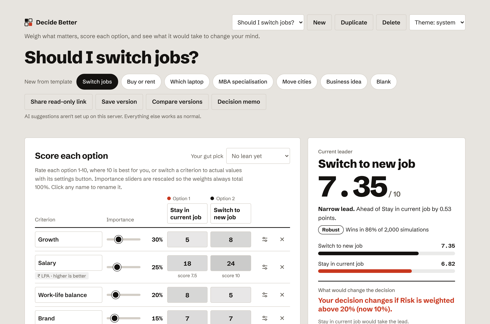
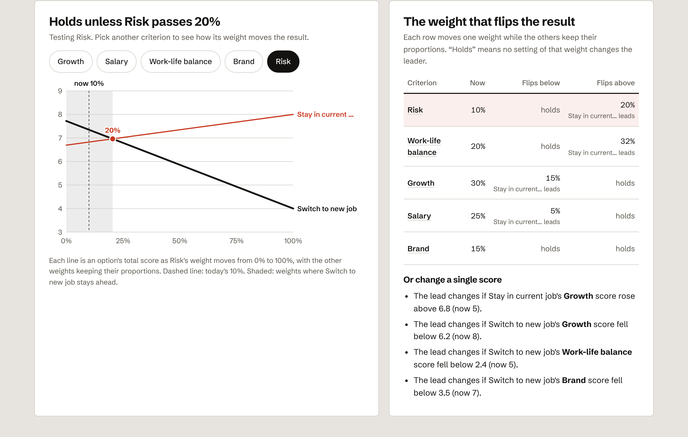
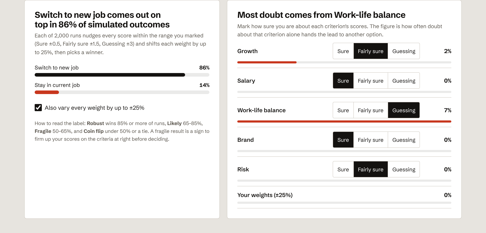
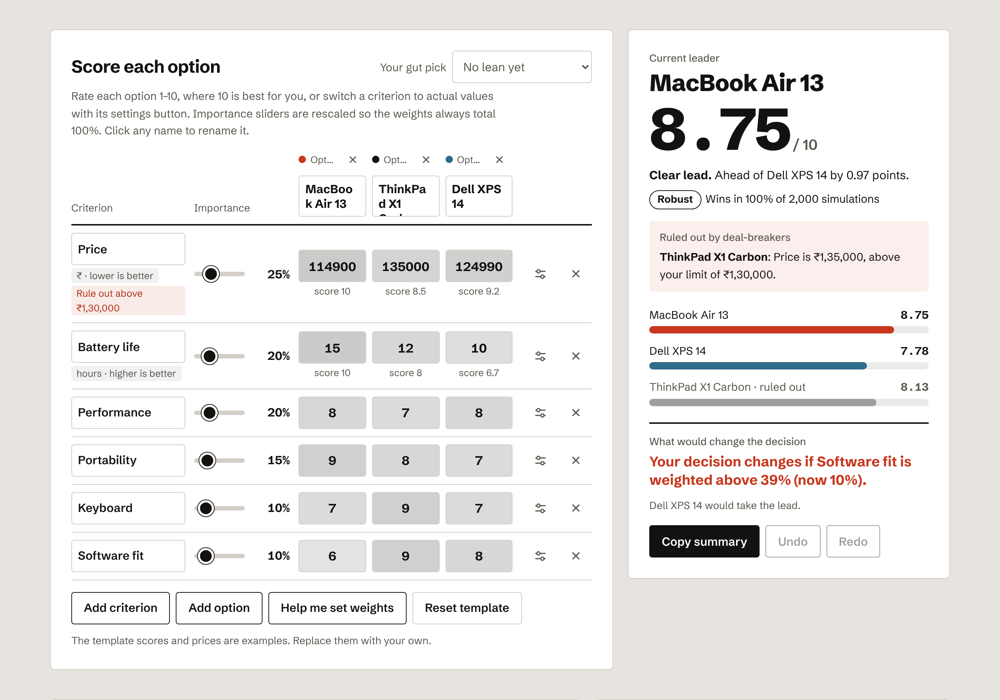
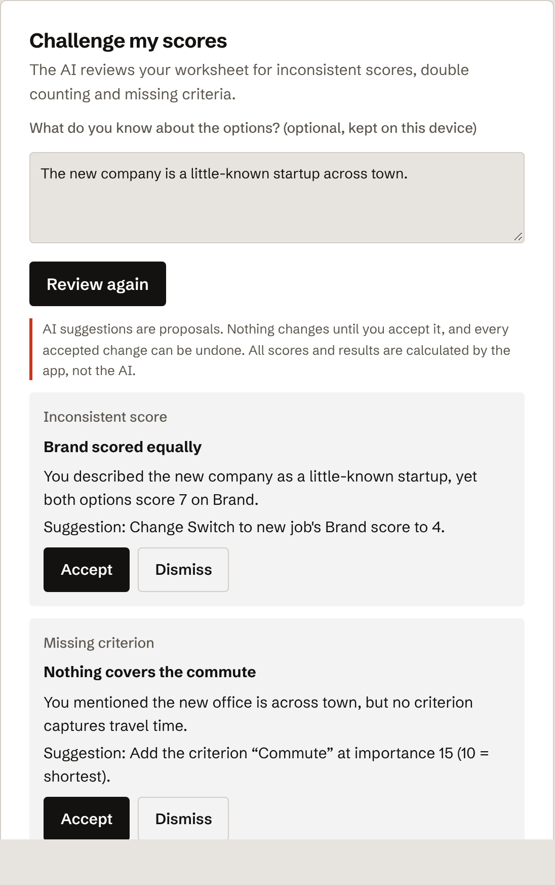
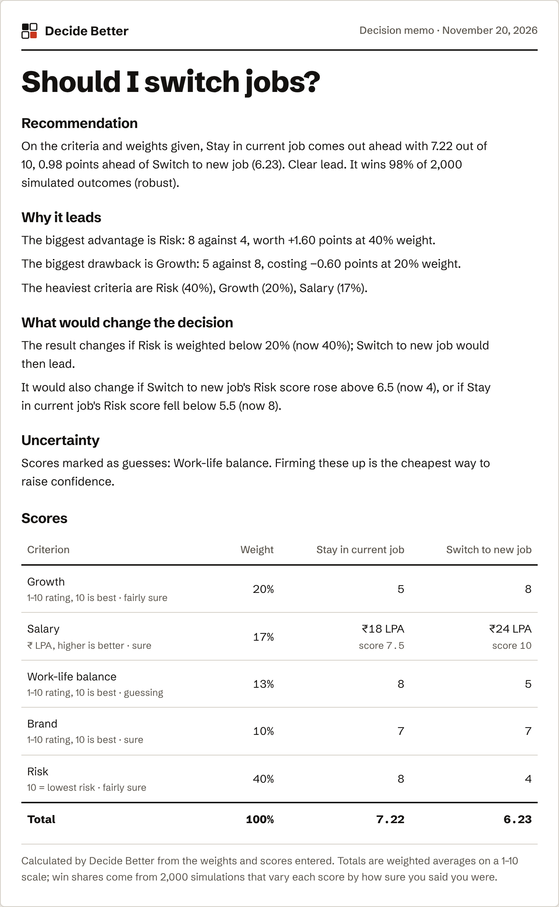
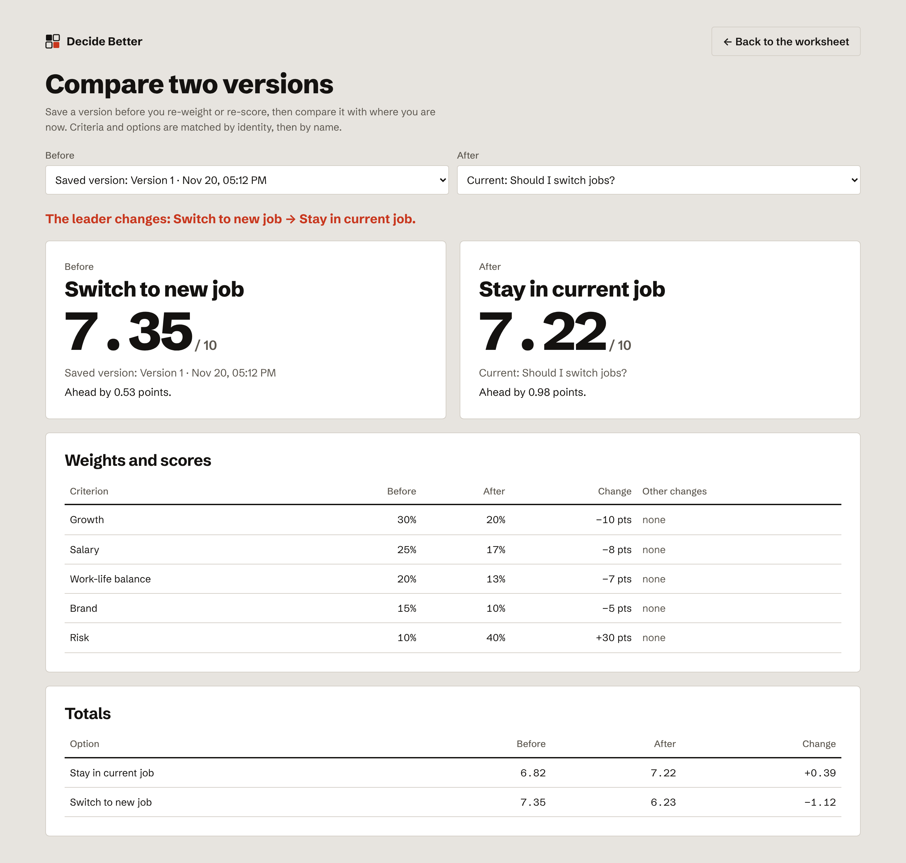
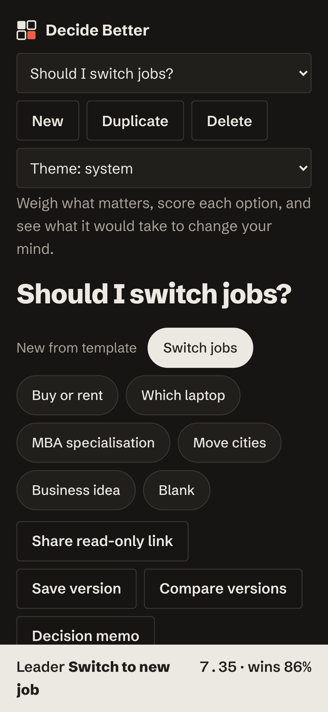
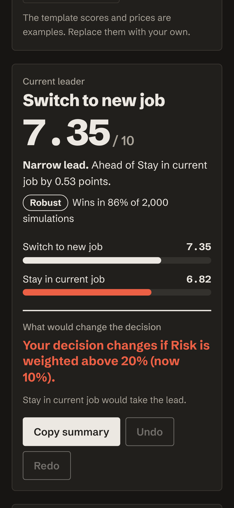

# Decide Better

[](https://github.com/kaurjacinth17/decide-better/actions/workflows/ci.yml)

**Less opinion, more structure.** Decide Better helps you choose between options — job offers, cities, laptops, MBA tracks, business ideas — by weighting what matters and scoring each option. It shows the winner, why it wins, how fragile that is, and exactly what would change the decision.

All scoring maths is deterministic, runs in your browser and is unit-tested. An optional AI layer can _propose_ options, criteria, challenges and write-ups, but you accept or reject every proposal. The AI never changes scores or weights by itself, and the app works fully without it.



|                                                                                                      |                                                                                    |
| ---------------------------------------------------------------------------------------------------- | ---------------------------------------------------------------------------------- |
|                                 |                |
|  |  |
|                                                 |                  |

<p>
  
  
</p>

---

## Quick start

Requires Node.js 22+ and pnpm 10.

```bash
pnpm install
```

```bash
pnpm dev
```

Open http://localhost:3000. The app opens on the _Should I switch jobs?_ template.

### Turning on the AI layer (optional)

```bash
cp .env.example .env.local
```

Then set `ANTHROPIC_API_KEY` in `.env.local` and restart. Without a key, the AI controls are hidden behind a one-line notice and everything else works as normal.

| Variable            | Default             | Purpose                                                               |
| ------------------- | ------------------- | --------------------------------------------------------------------- |
| `ANTHROPIC_API_KEY` | —                   | Server-side only; never sent to the browser.                          |
| `ANTHROPIC_MODEL`   | `claude-sonnet-5-5` | Model used by every AI feature.                                       |
| `AI_RATE_LIMIT`     | `30`                | AI requests per browser session per hour (the per-IP backstop is 3×). |

`.env.local` is git-ignored. Never commit keys.

### Scripts

| Command                                        | What it does                                                                                                       |
| ---------------------------------------------- | ------------------------------------------------------------------------------------------------------------------ |
| `pnpm dev`                                     | Development server                                                                                                 |
| `pnpm build` / `pnpm start`                    | Production build / serve it                                                                                        |
| `pnpm lint` / `pnpm typecheck` / `pnpm format` | ESLint, `tsc --noEmit`, Prettier                                                                                   |
| `pnpm test`                                    | Vitest: engine fixtures, property tests, store, schemas, AI handlers (fake model)                                  |
| `pnpm e2e`                                     | Playwright: happy paths, accessibility (axe-core), share/PWA/compare/memo, AI UI (mocked). Run `pnpm build` first. |
| `pnpm test:live`                               | Optional live smoke test of the four AI features against the real API. Skipped without a key; costs a few cents.   |

---

## What it does

**Worksheet (same behaviour as the original prototype).**

- **Library:** keep many decisions, with New, Duplicate and a two-step Delete.
- **Templates:** seven ready-made ones (switch jobs, buy or rent, laptop, MBA specialisation, move cities, business idea, blank).
- **Matrix:** 2–5 options and 1–10 criteria. Importance sliders always add up to 100%.
- **Scoring:** rate each option 1–10, or enter actual values (₹, hours) with a unit and a "higher/lower is better" setting.
- **Deal-breakers** rule out options that break a limit.
- **Verdict panel:** score, margin, win %, which options were ruled out, the single change that would flip the result, and a gut check.
- **Breakdown:** a points table and the leader's biggest advantage and drawback.
- **Uncertainty:** a simulation panel with Sure / Fairly sure / Guessing toggles per criterion.
- **Sensitivity:** a chart with criterion chips, a flip table, and the single-score changes that would flip the result.
- **Weight helper:** pairwise questions that suggest weights.
- **Also:** undo/redo (Ctrl/Cmd+Z), export/import (old prototype exports work), and Copy summary as Markdown.

**New in this version.**

- **Read-only share links.** The decision is compressed into the link itself (the part after `#`, which browsers never send to a server). Opening a link shows a read-only view with a _Make a copy_ button.
- **Installable and offline.** It's an installable web app (PWA) that works offline after the first visit.
- **Compare versions.** Save a version, re-weight or re-score, then compare before and after side by side: weights, score changes, totals and whether the leader changed.
- **Decision memo.** A print- and PDF-friendly one-page memo built from the engine's results.
- **AI layer** (optional): plain-text intake, a score challenger, a gut interview, and an AI-written memo. See [AI layer](#ai-layer).
- **Accessibility.** Light, dark and system themes. Works at 360px wide, fully keyboard-accessible with visible focus, and every touch target is at least 44px. axe-core finds no serious or critical issues.

---

## The maths in plain English

Everything below lives in `src/engine/` (pure TypeScript, no React) and was ported exactly from the prototype. The figures quoted come from the unit-test fixtures.

**1. Weights.** Each criterion has an importance slider from 0 to 100. Only the proportions matter: a criterion's weight is its slider value divided by the sum of all sliders, so weights always add up to 100%. If every slider is at 0, all criteria count equally.

**2. Turning everything into a 1–10 score.**

- _Rating mode:_ your 1–10 rating is used as is.
- _Actual values:_ the best option gets 10 and the others get a proportional share. When higher is better, an option with half the best value scores 5. When lower is better (e.g. price), an option that costs twice the cheapest scores 5. For example, salaries of 18 and 24 LPA become 7.5 and 10.
- If any value is zero or negative, ratios don't work. The range is then stretched from 1 (worst) to 10 (best) instead.
- If all values are equal, every option gets 10. A missing value counts as a neutral 5.

**3. The total.** Each option's total is the weighted average of its scores, so it is also on a 1–10 scale. _Switch jobs:_ Switch 7.35, Stay 6.825 (shown as 6.82, matching the prototype's rounding).

**4. Deal-breakers.** A deal-breaker rules an option out if it scores below your minimum, or if its actual value is past your limit (below for higher-is-better, above for lower-is-better). Ruled-out options stay visible, but they can't win and are left out of the sensitivity analysis and simulations. _Laptop:_ the ThinkPad (₹1,35,000) breaks the ₹1,30,000 price limit, so the MacBook Air (8.75) leads the Dell (7.78).

**5. What would flip the result?** Take one criterion and slide its weight from 0% to 100% while the others keep their proportions. Every option's total then moves in a straight line, so the exact weight where another option overtakes the leader is where two lines cross. The app reports the nearest flip above and below today's weight for every criterion, and headlines the smallest change overall. _Switch jobs:_ the result flips if Risk is weighted above about 20.4% (now 10%). _MBA:_ if Course load goes above about 63%.

**6. Single-score changes.** Changing one rating by Δ changes a total by _weight × Δ_. So for the runner-up to catch up, a rating must rise by _gap ÷ weight_, or the leader's must fall by the same amount. The app lists the four smallest such changes that stay within 1–10.

**7. How sure is the result?** The app re-runs the decision 2,000 times, nudging every score at random within how sure you said you were: ±0.5 for _Sure_, ±1.5 for _Fairly sure_, ±3 for _Guessing_. Optionally it also nudges every weight by up to ±25%. The win share gives the label:

- **Robust:** 85% or more.
- **Likely:** 65% or more.
- **Fragile:** 50% or more.
- **Coin flip:** below 50%, or an exact tie.

Separately, it re-runs 400 times varying only one criterion at a time (or only the weights) to show where the doubt comes from. The random numbers come from a fixed seed, so results don't jitter while you type. The simulation runs in a Web Worker and waits 150 ms after your last keystroke before re-running.

**8. Gut check.** If your gut picks a different option from the leader, the app finds the criterion that contributes most to the leader's advantage. It then finds the smallest single weight change that would make your pick the overall leader, checked against every eligible option, not just the leader.

**9. "Help me set weights."** You compare criteria in pairs (a lot more, a little more, the same…). Weights come from the geometric means of the answer matrix, a lightweight version of the Analytic Hierarchy Process. A consistency ratio above 0.1 means your answers contradict each other, and the app says so.

---

## AI layer

**The principle.** The engine computes; the AI only proposes. Every suggestion is shown with a visible note saying it's a proposal. Nothing changes until you accept it, and every accepted change is an ordinary undoable edit.

| Feature                 | What you get                                                                                                                                                                                                   | Guardrails                                                                                                                                                                                                          |
| ----------------------- | -------------------------------------------------------------------------------------------------------------------------------------------------------------------------------------------------------------- | ------------------------------------------------------------------------------------------------------------------------------------------------------------------------------------------------------------------- |
| **A. Intake**           | Describe the dilemma in plain text. You get a proposed title, 2–5 options, 4–8 weighted criteria with scale notes, which criteria should use actual values (unit and direction), and deal-breakers you stated. | Shown as an item-by-item diff: keep or drop, rename, re-weight, then create. Actual values are only filled in when you stated them. Every rating starts at a neutral 5 for you to score.                            |
| **B. Score challenger** | Flags likely issues, e.g. "you scored Brand equally but described one company as unknown", double counting, a missing criterion, or a scale running the wrong way.                                             | Each flag has _Accept_ / _Dismiss_. Suggestions naming criteria or options that don't exist are dropped.                                                                                                            |
| **C. Gut interview**    | When your gut disagrees with the leader, it asks up to 3 short questions, then proposes the missing criterion.                                                                                                 | Shows an engine-computed preview of the result before you add it. The new criterion is marked _Guessing_.                                                                                                           |
| **D. Decision memo**    | A plain-English one-page memo.                                                                                                                                                                                 | It receives only the engine's pre-formatted figures. Any number in its text that isn't one of those triggers one corrective retry; if it still invents figures, the draft is discarded and the standard memo stays. |

**How it's built.**

- **Server side only.** All calls go through Next.js route handlers in `src/app/api/ai/*`, using the Anthropic TypeScript SDK. The key never reaches the browser.
- **Structured outputs.** Responses use structured outputs (`output_config.format` with Zod schemas). Forced `tool_choice` is rejected by Claude Sonnet 5.5, so JSON-schema structured output is the supported way to get guaranteed JSON.
- **Second validation pass.** A stricter Zod check (`sanitise*` in `src/lib/ai/schemas.ts`) runs on every model output.
- **Refusal fallback.** For models that support it, the server-side refusal fallback (`fallbacks: "default"`) is on: if the model declines on policy grounds, the API retries on a suitable fallback model in the same call.
- **Request limits.** Per-session rate limit (an httpOnly cookie) with a per-IP backstop, a same-origin check, a 64 KB body limit, a 60 s timeout and 2 automatic retries.
- **Friendly failures.** Errors map to clear messages (busy, timeout, declined, invalid output, offline, not configured). The rest of the app never depends on an AI response.
- **What is sent.** Option and criterion names, weights, ratings and values, the engine's totals, and any text you type into an AI panel. Notes you add for the challenger stay on your device until you send them.
- **A switch.** You can turn AI suggestions off in the header.

---

## Architecture

```
src/
  engine/       Pure maths, no React: model.ts (weights, derived scores, totals, deal-breakers),
                sensitivity.ts (line crossings, score flips), simulate.ts (seeded Monte Carlo),
                gut.ts, ahp.ts, analyse.ts (one call → every deterministic fact), format.ts
  templates/    The seven prototype templates, verbatim
  store/        Zustand store (live edits + one undo step per commit, 80-step history),
                ops.ts (pure edit operations), Dexie/IndexedDB adapter + in-memory adapter for tests,
                migration of the prototype's localStorage library
  lib/          schema.ts (Zod validation + prototype migration), share.ts (lz-string links),
                compare.ts, memo.ts (memo facts + invented-number guard), ai/ (schemas, brief, client, apply)
  server/ai/    generate.ts (the only SDK call), handlers.ts (pure, injectable), prompts.ts,
                route.ts (rate limit, origin, size, errors), errors.ts, rateLimit.ts
  workers/      sim.worker.ts — the simulation off the main thread
  components/   Matrix, VerdictPanel, Breakdown, Uncertainty, Sensitivity (+FlipTable), WeightHelper,
                Header/Library, Toolbar, ShareView, CompareView, MemoView, ai/*
  app/          Routes: / (worksheet), /view (shared, read-only), /compare, /memo, /api/ai/*
public/sw.js    Hand-written service worker (precache pages + assets, never touches /api)
```

**How data flows:**

```
store (Zustand) ──► analyse(decision) ──► WorkspaceContext ──► every panel
     ▲                        └──► sim worker (debounced 150 ms) ─┘
     └── edit / commit / undo ◄── UI inputs, accepted AI proposals
```

- **Shared components.** Every panel reads one `WorkspaceContext`: the decision, its analysis, the simulation result and the edit functions. The editable worksheet and the read-only shared view render the same components; the shared view simply passes no-op edit functions.
- **Persistence.** Decisions are stored in IndexedDB through Dexie, behind a small adapter interface, so unit tests use an in-memory adapter. Rows are re-validated with Zod on load. On first run, a library left by the prototype in `localStorage` is migrated automatically.
- **No server data.** The app has no accounts and stores nothing about you on a server. The only server code is the optional AI routes.

---

## Testing

| Suite                                                            | What it covers                                                                                                                                                                                                                                                                                   |
| ---------------------------------------------------------------- | ------------------------------------------------------------------------------------------------------------------------------------------------------------------------------------------------------------------------------------------------------------------------------------------------ |
| `tests/unit/fixtures.test.ts`                                    | The brief's fixtures: Job 7.35 / 6.825 with the Risk flip at ≈20.4%; Salary 18/24 → 7.5/10; MBA 8.10 / 6.65 / 6.25 with the Course load flip at ≈63%; the ThinkPad ruled out and the MacBook 8.75 vs Dell 7.78; Blank is an exact tie labelled Coin flip                                         |
| `tests/unit/engine.test.ts`                                      | Property tests over 300 seeded random decisions: weights sum to 1; f(wᵢ) equals the total; every reported flip really changes the leader, and every score flip lands on an exact tie. Plus value scaling, deal-breakers, the simulation, the gut check, the weight helper and the summary format |
| `tests/unit/store.test.ts`, `schema.test.ts`, `features.test.ts` | Undo/redo cap, persistence, prototype migration, Zod validation, share links, compare, memo facts and the invented-number guard                                                                                                                                                                  |
| `tests/unit/ai.test.ts`                                          | AI handlers with a fake model: sanitising, the gut-question cap, memo retry and discard, rate limit, same-origin, SDK error mapping, and that no secrets leak                                                                                                                                    |
| `tests/e2e/*.spec.ts`                                            | Playwright on a desktop and a 360px phone: happy paths, persistence across reloads, axe-core in light and dark, 44px targets, keyboard and focus, share/copy, offline reload, compare, memo, and the AI UI (mocked) including "no key"                                                           |

---

## Deployment

The app is a standard Next.js project. The worksheet itself is static, but the optional AI routes need a server, so deploy to a host that runs Next.js server code. Vercel is the simplest.

### Vercel (recommended)

1. **Import the repository.** In Vercel, choose _Add New → Project_, give Vercel access to `kaurjacinth17/decide-better`, and import it. It detects Next.js and pnpm on its own, so leave the build settings as they are.
2. **Add environment variables** (_Settings → Environment Variables_):
   - `ANTHROPIC_API_KEY`: your key. Add it to **Production** only, unless you want preview deployments to spend credits too.
   - `ANTHROPIC_MODEL` and `AI_RATE_LIMIT`: optional; the defaults are above.

   Skip the key entirely and the app deploys with AI hidden.

3. **Deploy.** After that, every push to `main` redeploys production, and every pull request gets its own preview URL.
4. **Smoke-test the live site:**
   - The worksheet loads with the _Switch jobs_ template.
   - `/api/ai/status` returns `{"available":true,...}` if you set a key.
   - _Share read-only link_ opens in a private window.
   - After one visit, the page still loads with the network off.

**Two things to know before sharing the link widely:**

- **AI spending.** The per-session rate limit is held in memory, and Vercel runs several function instances, each with its own count. That makes it a soft limit. Set a monthly spend limit for the key in the Anthropic Console; that's the real cap. For a hard limit across instances, replace `src/server/ai/rateLimit.ts` with a shared store such as Upstash Redis or Vercel KV.
- **Request time.** Each AI route declares `maxDuration = 60` (seconds) and stops its own model call at 55 seconds with a friendly "took too long" message, so requests fit inside the function time limit.

### Other hosts

Anything that can run `pnpm build && pnpm start` on Node.js 22 works, such as Render, Fly.io or a Docker container. Set the same environment variables. The service worker cache is versioned per build, so after a deploy, returning visitors get fresh offline assets.

### Continuous integration

`.github/workflows/ci.yml` runs on every push to `main` and every pull request:

- lint, format check, typecheck and unit tests;
- a production build;
- the full Playwright suite (desktop and a 360px phone, including the axe accessibility checks).

It deliberately runs without an API key: the AI routes are mocked, and one test confirms the app works fully without them. If a run fails, the Playwright report is attached as an artifact.

## Migrating from the prototype

Opening the new app in the same browser imports the prototype's saved library automatically. You can also paste anything the prototype's _Copy this decision_ produced into **Export or import a decision**. Both go through the same Zod schema, which fills defaults and clamps values just as the prototype's own loader did.
